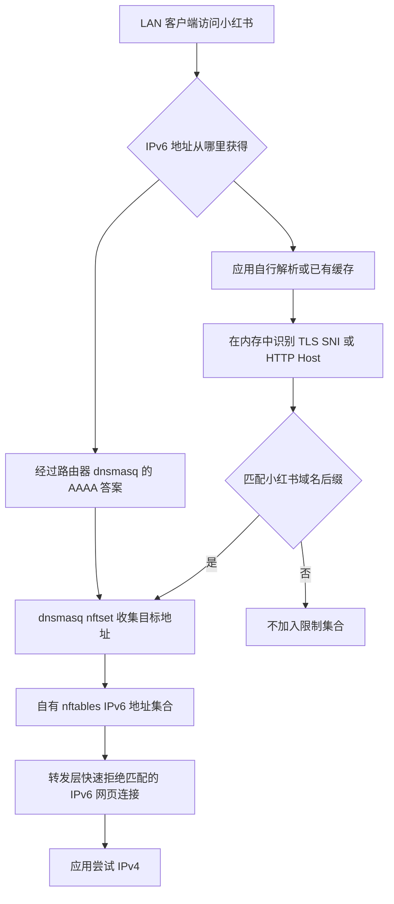

# 小红书 IPv6 连接缓慢修复（OpenWrt / iStoreOS）

为 OpenWrt / iStoreOS 提供小红书 IPv4 优先的轻量服务。针对“小红书部分 IPv6 CDN 连接卡住，图片、头像长时间留白，而 IPv4 正常”的场景，让识别到的小红书网页连接尽快回退到 IPv4。

**不关闭全局 IPv6，不要求流量进入代理软件内核。** 使用路由器本机的 dnsmasq、nftables、tcpdump、Lua 和 procd；没有 Docker、云端接口或账号配置。

当前版本：`0.1.0`。这是命令行安装的实验性服务，尚未打包为 LuCI 页面、IPK 或 APK 安装包。基本机制来自实际家庭网络排障；新整理的通用安装器仍需要更多不同固件的验证。

## 适用条件

| 条件 | 要求 |
|---|---|
| 路由器系统 | 使用 firewall4 / nftables、procd 的 OpenWrt 或 iStoreOS |
| 权限 | 能通过 SSH 使用 root |
| 流量路径 | 设备的 IPv6 流量经过该路由器转发，且来自一个指定 LAN 接口，默认 `br-lan` |
| IPv4 | 设备必须能够正常访问小红书的 IPv4 服务；本项目不修复 IPv4 出口问题 |
| DNS | 一个默认 dnsmasq 实例，实际加载 `/etc/dnsmasq.conf`，并支持 `nftset` |
| 防火墙 | `nft` 可用，运行中的 `inet fw4` 表存在，允许创建带超时的 IPv6 地址集合 |
| 捕获与识别 | `tcpdump` 支持 `-Q in` 和 IPv6 TCP 过滤；`lua` 可执行文件可用，解析器以 Lua 5.1 验证 |
| 基础命令 | BusyBox/POSIX shell，以及 `timeout`、`nslookup`、`mkfifo`、`mktemp`、`logger`、`ip`、`awk` 等常规命令 |

不适用于仅支持 iptables/fw3 的旧系统、普通原厂路由器固件，或流量完全绕过此路由器的客户端。多 dnsmasq 实例、自定义独立配置路径、多个 LAN 桥需要自行适配，安装器会拒绝检测到的不支持配置。

本项目不会自动安装或替换系统软件包。依赖缺失时，先使用对应固件的软件包管理器补齐；不同版本可能使用 `opkg` 或 `apk`。尤其不要不看固件要求就直接替换 dnsmasq：它同时承担 DNS/DHCP。`dnsmasq-full` 通常提供需要的功能，但应以本机 `dnsmasq --version` 的 `nftset` 标识为准。

## 安装

在自己的电脑下载仓库 ZIP 并解压后，将整个目录上传到路由器，例如 `/tmp/openwrt-xiaohongshu-ipv6-slow-fix`；也可以在已安装 Git 的路由器上执行：

```sh
git clone https://github.com/fredqin2006-X/openwrt-xiaohongshu-ipv6-slow-fix.git
cd openwrt-xiaohongshu-ipv6-slow-fix
```

先检查条件，检查模式不改系统配置、不开服务、不创建持久备份：

```sh
sh install.sh --check
```

通过后安装：

```sh
sh install.sh
```

如果实际 LAN 接口不是 `br-lan`：

```sh
sh install.sh --check --interface br-home
sh install.sh --interface br-home
```

`br-home` 是示例，应替换成真实的 **LAN 三层接口**；不要填 WAN、PPPoE、IPTV 桥或 IPTV VLAN 接口。可先用 `ip link show` 和固件网络页面核对。

安装器会检查条件、保存一份原始 DNS 配置、写入自有文件、添加独立 DNS 标记段、创建自有规则表、启用自启动并重启 dnsmasq。**DNS 服务会短暂重启**。安装失败会尝试恢复刚才的 DNS 配置并移除本次服务；不修改网络接口、VLAN、现有 firewall4 配置或 Open-Box 配置。

安装同版本、同接口时再次执行会直接提示已安装，不重复创建备份。发现其他版本或旧手工部署时会退出，不覆盖。升级需先卸载旧版本，再安装新版本。早期手工部署先用当时保留的 `/usr/libexec/xhs-ipv4-rollback` 回退。

## 使用与状态

```sh
/usr/libexec/xhs-ipv4-control status
```

重点查看：服务是否 `running`、LAN 接口是否正确、集合是否出现地址，以及规则中的 `counter packets` 是否增长。计数器仅统计被拒绝的目标 IPv6 报文；没有增长不一定异常，应用可能已经使用 IPv4。

```sh
logread -e xhs-ipv4
```

安装后先退出并重新打开小红书，再刷新获取新的内容。能显示已有缓存并不能单独证明网络恢复；应同时观察新图片、头像和连接状态。不需要在手机上安装证书、代理或辅助应用。

服务由 procd 管理，开机自动启动。修改接口设置后可重启自有服务：

```sh
/etc/init.d/xhs-ipv4 restart
```

不要只关闭自启动或停止服务来当作完整卸载，DNS 标记段仍可能引用已经删除的集合。

## 完整卸载

```sh
/usr/libexec/xhs-ipv4-uninstall
```

或在仓库目录执行：

```sh
sh uninstall.sh
```

卸载会删除本项目的 DNS 标记段，重启 dnsmasq，然后关闭自启动、停止进程、删除自有规则表和安装文件。它只移除自己的配置段，保留其他后来修改的 DNS 设置，不用历史备份覆盖整份当前配置。

安装前原始配置 `/etc/xhs-ipv4-backup/dnsmasq.conf.original` 会保留供人工核查。这个固定路径**只在首次安装时创建一次**，重装也不覆盖；后台、开机、刷新域名和服务重启都不会再备份。

## 工作原理



默认覆盖四组域名后缀及其子域名：

```text
xiaohongshu.com
xhscdn.com
xhscdn.net
xhsrcdn.com
```

- **DNS 收集**：只将这些域名解析出的 IPv6 地址加入集合，既不拦截 IPv4，也不启用全局 AAAA 过滤。
- **补充学习**：tcpdump 监听指定 LAN 接口的入方向 IPv6 TCP 80/443 报文，通过内存管道交给 Lua；Lua 解析明文可见的握手域名，只把匹配目标的具体 IPv6 地址写入集合，不解密 HTTPS。
- **内核限制**：在独立 `inet xhs_ipv4` 表的 forward 钩子中，以优先级 `-10` 检查。来自指定 LAN、目标在集合内的 TCP 80/443 返回 RST，UDP 443 返回 ICMPv6 端口不可达。规则位于常规 fw4 established 接受规则之前，不依赖 Open-Box 分流。
- **定期维护**：地址集合默认一小时过期，上限 4096 项；每五分钟查询已知主机名，每十五秒检查自有规则表是否仍存在。表被清除后会重建，但地址需要重新收集，存在短暂恢复窗口。

它是一种故障绕行办法，不代表已经定位或修复底层 IPv6 链路故障。更多实现细节见 [工作原理](docs/architecture.md)。

## 资源、隐私与磁盘写入

原始家庭部署一次测得常驻进程 RSS 合计约 **6.5 MB**，其中 tcpdump 约 3.4 MB、Lua 约 1 MB，其余为 shell；这只是当时的参考值，未包含额外的内核抓包缓冲、地址集合及临时 DNS 查询进程，也不是峰值承诺。短时低负载采样中 CPU 增量低于采样分辨率；高吞吐、多设备和大量 IPv6 网页连接会增加 CPU 占用。

捕获器会看到指定接口上符合过滤条件的所有 IPv6 TCP 80/443 报文，**不是只捕获已经识别成小红书的报文**；解析后只对目标域名采取动作。报文通过权限受限的 FIFO 在内存中传递，不写常规 pcap 文件，不保存请求路径、Cookie、账号或原始流量，不上传遥测。

常态下不持续写闪存。地址、解析暂存、FIFO 和默认系统日志主要位于内存；若固件自行启用了持久日志，其少量启动/错误日志可能随系统日志落盘。服务文件和首次安装备份保存在配置分区。详见 [资源与维护](docs/operations.md)。

## 范围和已知限制

1. **地址级规则不等于逐请求域名防火墙**：一个被识别出的 IPv6 地址可能也被其他站点共享，这些站点相同端口的 IPv6 连接也会回退。项目使用具体地址和超时降低范围，但无法消除共享 CDN 的影响。
2. **学习不保证完整覆盖**：只有加密 DNS + QUIC、ECH 隐藏真实域名、非标准端口、部分 IPv6 扩展头或抓包丢包等情况，可能无法学习新地址。UDP 443 只限制已经进入集合的目标，不解析 QUIC 域名。
3. **第一次连接可能先失败**：通过 SNI 学习的新地址，首个握手包可能已经离开路由器，后续重试命中限制后才回退；回退行为由客户端实现决定。
4. **只作用于指定接口和转发路径**：不限制路由器自身发起的连接；本地代理终止连接后重新发起的其他路径、桥内不经三层转发的流量、硬件/软件加速绕过相关钩子的流量，需要单独核对。项目不主动修改这些加速设置。
5. **保留 IPTV 配置不等于所有拓扑均无影响**：安装器不修改 IPTV、VLAN 或组播，但接口选错、共享目标地址、系统 DNS 重启仍可能影响特定环境。应先核对 LAN 接口。
6. **平台验证有限**：原始版本已在一台 iStoreOS / firewall4 路由器与真实手机上验证冷启动、刷新、IPv4 图片传输和规则命中；尚未完成所有固件、整机重启链路及长期稳定性验收。

常见排查步骤见 [故障排查](docs/troubleshooting.md)。

## 开发与验证

```sh
python3 tests/test_learner.py --lua lua -v
```

测试只生成合成报文并以 `--dry-run` 调用解析器，不需要 root，不联网、不运行 nft 写入，也不包含真实家庭抓包。CI 同时检查 shell 语法。通过这些检查不代表完成路由器安装或手机使用验收。

项目使用 MIT 许可。依赖由系统提供，各自遵守其上游许可。

参考：[dnsmasq 官方手册](https://thekelleys.org.uk/dnsmasq/docs/dnsmasq-man.html)、[OpenWrt firewall4](https://git.openwrt.org/project/firewall4/)、[OpenWrt procd 服务文档](https://openwrt.org/docs/guide-developer/procd-init-script-example)。
